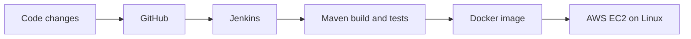

  
  <h1>Hi, I'm Sagar Sawant 👋</h1>
  
<strong>DevOps | Cloud Engineering | CI/CD</strong>

  
Building automated delivery workflows and containerized applications

  

    
    
  

  

    
    
    
  

## About me

I'm a Computer Engineering professional developing hands-on skills in **DevOps, cloud engineering, and application delivery**. I have practical experience with Git and GitHub, Docker, Jenkins, Maven, CI/CD workflows, and AWS fundamentals. I enjoy automating build and deployment steps, containerizing applications, and troubleshooting Linux-based environments.

- 🔄 Build automation and CI/CD with **Jenkins** and **Maven**
- 📦 Containerize applications with **Docker**
- ☁️ Work with **AWS EC2, IAM, S3**, security groups, and basic networking
- 🐧 Use **Linux, Ubuntu**, and Bash/Shell scripting
- 🌿 Manage source code with **Git** and **GitHub**
- ☕ Develop with **Java** and **Spring Boot REST APIs**

## How I ship

## Technology stack

  

| Area | Tools and technologies |
| --- | --- |
| Programming | Java, HTML, SQL |
| CI/CD and build | Jenkins, Maven, CI/CD, build and deployment automation |
| Containers | Docker, Dockerfiles, images, containers, networks, volumes |
| Cloud | AWS EC2, IAM, S3, security groups, basic networking |
| Linux and scripting | Linux, Ubuntu, Bash/Shell scripting |
| Version control | Git, GitHub, branching, merging, conflict resolution |

## Featured project

### 🚀 End-to-End CI/CD Pipeline for a Dockerized Spring Boot Application

An automated workflow for integrating source code, building and testing a Maven application, containerizing it with Docker, and deploying it to an AWS EC2 Linux/Ubuntu environment.

- Connected GitHub source control with Jenkins pipeline automation
- Used Maven for application builds and testing
- Created Docker images and worked with containers, port mapping, networks, and volumes
- Deployed the containerized application to AWS EC2
- Configured security groups, ports, and basic cloud networking

## Training

### Java Full Stack Development and DevOps Training — QSpiders, Wakad, Pune

Currently pursuing practical training in Linux, Git/GitHub, Maven, Jenkins, Docker, and CI/CD workflows.

- Practicing automated builds and pipelines with Jenkins and Maven
- Using Git and GitHub for version control, branching, merging, and conflict resolution
- Developing Spring Boot REST APIs
- Containerizing applications and practicing deployment and troubleshooting

## Education

| Qualification | Institution | Year | Result |
| --- | --- | --- | --- |
| B.Tech | Fabtech Technical Campus, Sangola | 2026 | CGPA: 8.11 |
| HSC (12th) | M.V. High and Jr. College, Umadi | 2022 | 64.50% |
| SSC (10th) | Chh. Sambhaji Raje Sainik School, Jamge | 2020 | 85.60% |

## Let's connect

I'm interested in DevOps, cloud engineering, automation, and deployment workflows. Feel free to connect.

- [LinkedIn](https://www.linkedin.com/in/sagar-sawant-151382424)
- [Email](mailto:sawantsagar37205@gmail.com)
- [GitHub](https://github.com/SagarSawant2611)

  Build. Automate. Containerize. Deploy.
   
  

