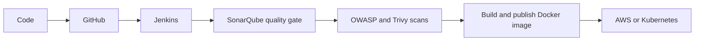

  
  <h1>Hi, I'm Suchith K 👋</h1>
  
<strong>DevOps Engineer | Cloud | DevSecOps</strong>

  
Automating cloud infrastructure · Building CI/CD pipelines · Integrating security into delivery

  

    
    
  

  

    
    
    
  

## About me

I'm a DevOps Engineer based in Bengaluru, India, with close to **2 years of hands-on experience** in cloud infrastructure, automation, CI/CD, and containerization. I focus on building reliable deployment workflows, reducing repetitive work, and improving software delivery with DevOps and DevSecOps practices.

- ☁️ Cloud infrastructure on **AWS**
- 🧱 Infrastructure as Code with **Terraform**
- 🔄 CI/CD automation with **Jenkins**
- 📦 Containerization with **Docker**
- ☸️ Orchestration with **Kubernetes**
- 🛡️ Security and quality checks with **SonarQube**, **Trivy**, and **OWASP Dependency-Check**

**Open to:** DevOps, Cloud, and DevSecOps opportunities, as well as collaboration on open-source and cloud projects.

## How I ship

## Technology stack

  

| Area | Tools and technologies |
| --- | --- |
| Cloud and infrastructure | AWS (EC2, S3, CloudFront, Route 53, EKS), Terraform, Linux, Bash |
| Containers and orchestration | Docker, Kubernetes, Helm, MetalLB |
| CI/CD and version control | Jenkins, Git, GitHub, GitHub Actions |
| DevSecOps | SonarQube, Trivy, OWASP Dependency-Check |
| Monitoring and automation | Prometheus, Grafana, Ansible |

## Featured projects

### 🔐 DevSecOps pipeline
An automated delivery workflow with quality checks and vulnerability scanning.

- Jenkins pipeline automation
- SonarQube static analysis and quality gate
- Trivy container image scanning
- OWASP Dependency-Check

### ☁️ AWS cloud deployment
A container-based deployment workflow for a full-stack application on AWS EC2.

- AWS environment setup
- Docker application packaging
- Jenkins CI/CD integration
- Code quality and security checks

### ☸️ Kubernetes platform
Practice deploying and networking applications across Kubernetes clusters.

- Ingress and TLS
- Horizontal Pod Autoscaling
- Helm deployments
- LoadBalancer networking with MetalLB

### 🌐 AWS static website hosting
Static website delivery using AWS storage, CDN, and DNS services.

- S3 website assets
- CloudFront distribution
- Custom domain and DNS configuration
- HTTPS certificate setup and cache invalidation

[Explore my repositories →](https://github.com/Suchith-K-git?tab=repositories)

## GitHub activity

  
  
   
  
   
  

## Currently learning

- GitOps with **Argo CD**
- Observability with **Prometheus** and **Grafana**
- Cloud-native tooling

## Let's connect

I'm interested in cloud infrastructure, automation, and reliable software delivery. Feel free to reach out.

- [LinkedIn](https://www.linkedin.com/in/suchith-k-0262a5252/)
- [Email](mailto:suchith004@gmail.com)
- [GitHub](https://github.com/Suchith-K-git)

  Automate. Secure. Deploy. Improve.
   
  

